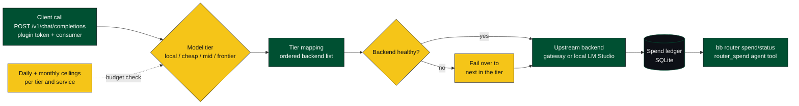

# bb-plugin-router

Cost-tiered model routing with budget ceilings for bb. This replaces the
Meadow LiteLLM router with a bb plugin that owns:

- OpenAI-compatible `POST /v1/chat/completions` and `POST /chat/completions`
  proxy routes protected by the plugin token.
- Spend targets for model tiers and cost-bearing external services.
- Daily and monthly ceilings stored in the plugin SQLite database.
- A spend ledger in the plugin SQLite database.
- Backend health checks with failover away from unhealthy deployments.
- `bb router ...` commands and the `router_spend` agent tool.

## How it works



## Configure

Secret settings are intentionally empty after install:

```bash
bb plugin config router set vercelAiGatewayApiKey <secret>
bb plugin config router set vercelAiGatewayBaseUrl https://ai-gateway.vercel.sh/v1
bb plugin config router set localBaseUrl http://100.79.149.24:1234/v1
bb plugin reload router
```

Generate a proxy token with:

```bash
bb plugin token router
```

Clients call:

```bash
curl "$BB_SERVER/api/v1/plugins/router/http/v1/chat/completions" \
  -H "x-bb-plugin-token: <router-plugin-token>" \
  -H "content-type: application/json" \
  -H "x-bb-router-consumer: workers" \
  -d '{"model":"cheap","messages":[{"role":"user","content":"hi"}]}'
```

## Install

From this directory:

```
bb plugin install .
```

After editing sources, reload:

```
bb plugin reload router
```

## Configure

```
bb router status
bb router tiers
bb router health
bb router ceiling frontier 2 20 --consumer workers
bb router record fal 0.42 --note image-generation --consumer agents
bb router spend --target frontier --since 2026-08-01
```

## Model Mapping

The mappings were carried from `/home/jose/meadow-router/config.yaml`:

- `local`: `qwen/qwen3.5-9b` on LM Studio at `http://100.79.149.24:1234/v1`.
- `cheap`: Vercel AI Gateway DeepSeek V3.2, then Gemini 3.1 Flash Lite.
- `mid`: Vercel AI Gateway Kimi K2.6, then GLM 4.6. `smart` normalizes here.
- `frontier`: Vercel AI Gateway Claude Fable 5, Claude Opus 4.8, then Gemini 3 Pro Preview.
- Ledger-only targets include `classify`, `embed`, `local-embed`, `fal`, and
  `vercel-ai-gateway`.
